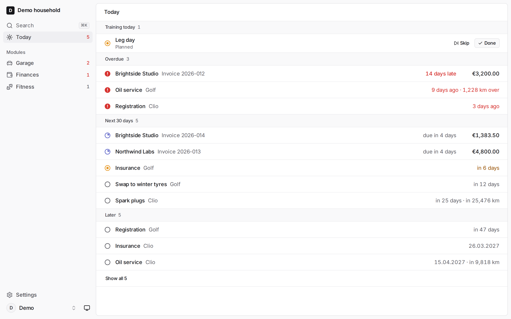
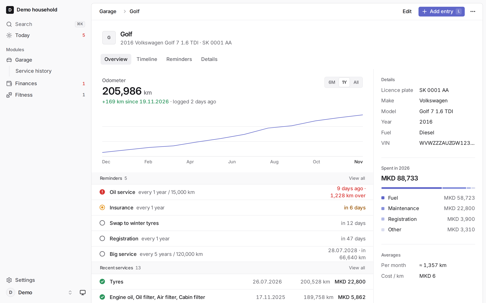
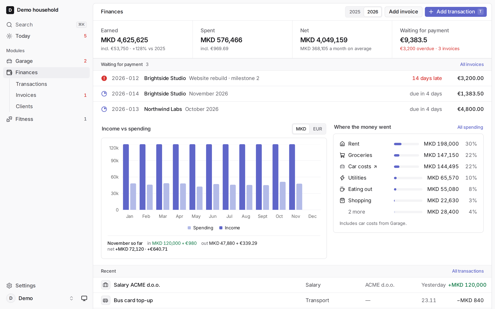
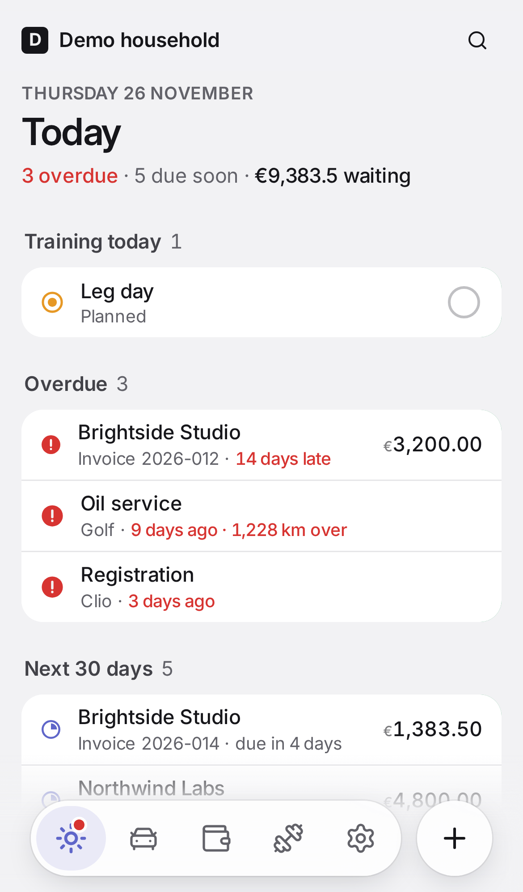
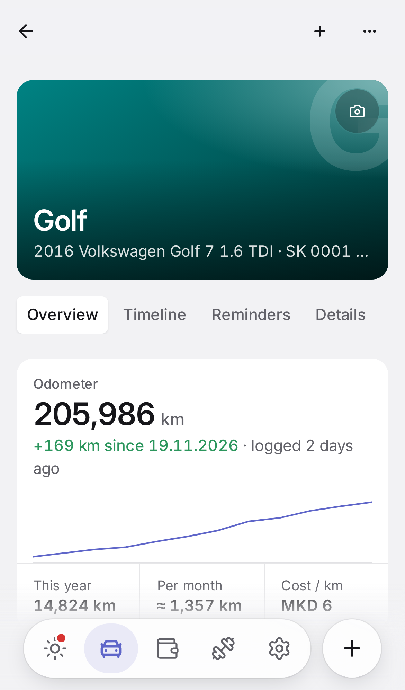
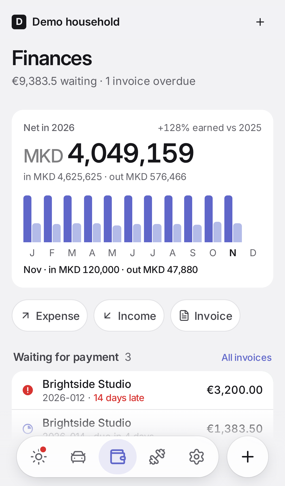
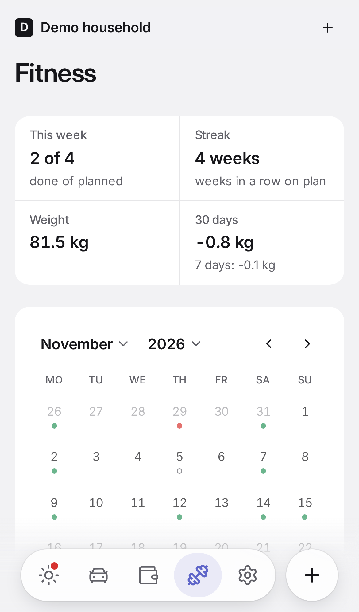

# LifeStash

A private, online-first PWA for keeping everyday records and reminders, on your PC and phone. **Garage**: cars, service history, mileage, upcoming maintenance with push notifications and car costs. **Finances**: income, spending and invoices. **Fitness**: trainings on a calendar and body weight. **Today** collects everything that needs action across them.

<picture><source media="(prefers-color-scheme: dark)" srcset="docs/screenshots/today-desktop-dark.png"></picture>

<p>
<picture><source media="(prefers-color-scheme: dark)" srcset="docs/screenshots/car-desktop-dark.png"></picture>
<picture><source media="(prefers-color-scheme: dark)" srcset="docs/screenshots/finances-desktop-dark.png"></picture>
</p>

<p align="center">
<picture><source media="(prefers-color-scheme: dark)" srcset="docs/screenshots/today-phone-dark.png"></picture>
<picture><source media="(prefers-color-scheme: dark)" srcset="docs/screenshots/car-phone-dark.png"></picture>
<picture><source media="(prefers-color-scheme: dark)" srcset="docs/screenshots/finances-phone-dark.png"></picture>
<picture><source media="(prefers-color-scheme: dark)" srcset="docs/screenshots/fitness-phone-dark.png"></picture>
</p>

Screenshots show the seeded demo household; regenerate them with `pnpm screenshots` (see [Demo data](#demo-data)).

Built with React + TanStack (Router, Query, Form) + shadcn/ui, a Hono API on a single Cloudflare Worker, Cloudflare D1, Backblaze B2 for receipt photos and Web Push for reminders. It runs on free tiers (no card needed at Cloudflare). See [`docs/ARCHITECTURE.md`](docs/ARCHITECTURE.md) and [`docs/DATA-MODEL.md`](docs/DATA-MODEL.md).

## Local development

Requirements: Node 22+ and pnpm.

```bash
pnpm install
pnpm db:migrate:local
pnpm dev
```

Open <http://localhost:5173>. The first visit sets up your account: choose **Email & password** (works on any device, including Linux PCs) or **Passkey** (fingerprint, face or device PIN). You get one-time recovery codes — save them. You can add the other sign-in method later in **Settings → Sign-in & security**.

Optional local secrets (photos and push) go in `.dev.vars`; copy `.dev.vars.example`.

### Local photo storage (Garage)

Photos and attachments need S3-compatible storage. Locally that's [Garage](https://garagehq.deuxfleurs.fr/) in Docker, so you don't need a B2 account:

```bash
pnpm storage:up
pnpm storage:setup
```

`storage:setup` creates the `lifestash-dev` bucket, a dev key and the CORS rule for `localhost:5173`, then writes the `B2_*` lines in `.dev.vars` (creating it from the example if needed). It is safe to re-run. Restart `pnpm dev` afterwards. Data lives in Docker volumes; `docker compose down -v` wipes it.

### Demo data

`pnpm db:seed` fills the local database with a demo household (four cars with years of services, fuel, renewals and reminders in every state) and prints its sign-in: `demo@lifestash.dev` / `lifestash-demo`. Dates are relative to today, so the data never goes stale. Re-running it replaces only the demo household; `pnpm db:seed --fresh` wipes the whole local database first.

`pnpm screenshots` signs in as the demo account and saves the README screenshots (desktop and phone, light and dark) to `docs/screenshots/`. It reuses a running `pnpm dev` or starts one.

The seed lives in `src/worker/db/seed/`:

- `fixtures/` — the data, written as habits and plans ("oil service every 12 months, next due in 9 days"). Edit these to change what you see.
- `seeders/` — one seeder per kind of record; `seeders.ts` lists them in order. Each gets a shared context with the household, today's date, a seeded random generator, and what earlier seeders created (cars, finance ids).
- `records/` — builders for rows that several seeders write (visits, expenses, recurring reminders).

To seed a new feature, add its fixture fields, write a `Seeder` (`{ name, run(ctx) }` returning counts) and append it to `seeders.ts`.

Useful scripts:

| Command | What it does |
| --- | --- |
| `pnpm check` | Generate routes, typecheck, lint, run tests |
| `pnpm fix` | Auto-fix formatting and lint issues |
| `pnpm test` | Unit tests (Vitest) |
| `pnpm db:generate` | Create a migration after changing `src/worker/db/schema/*` |
| `pnpm db:seed` | Fill the local database with demo data (`--fresh` to wipe first) |
| `pnpm build` | Production build (client + worker + service worker) |

## Deploying to Cloudflare (free)

1. Create a free Cloudflare account (no card needed) and log in:
   ```bash
   pnpm wrangler login
   ```
2. Create the database and put its id into `wrangler.jsonc` (`d1_databases[0].database_id`):
   ```bash
   pnpm wrangler d1 create lifestash
   ```
   The id already in `wrangler.jsonc` belongs to the maintainer's Cloudflare account and won't work for you, so replace it. (A D1 id is not a secret: it only works with that account's login.)
3. Apply migrations to the remote database:
   ```bash
   pnpm db:migrate:remote
   ```
4. Generate Web Push keys and store them as secrets (see below), then deploy:
   ```bash
   pnpm run deploy
   ```
   The app is served at `https://lifestash.<your-subdomain>.workers.dev`. Open it and create your passkey right away: until the first account exists, whoever opens the URL first can create it and becomes the admin. Sign-up closes automatically after that; invite others from **Settings → People**.

### Releasing updates

After the first deploy, ship every update with the release script from a clean `main` that matches `origin`:

```bash
pnpm release            # asks patch / minor / major
pnpm release minor      # bump without asking
pnpm release --dry-run  # checks and builds the next version; changes nothing
```

It shows the commits since the last tag and the pending migrations, runs `pnpm check`, bumps `package.json` (commit + tag `vX.Y.Z`), builds, applies remote D1 migrations, deploys, waits until `/api/version` reports the new version, then pushes `main` and the tag. If the build or deploy fails, the version commit and tag are undone. Settings shows the running version and commit. Set `LIFESTASH_URL` to verify a custom domain instead of the `workers.dev` URL.

Use `pnpm run deploy` (not `pnpm deploy`, which is a built-in pnpm command) only for a quick deploy without a version bump.

### Push notification keys

```bash
pnpm vapid
```

This prints a public key and a private key (JWK). Store them:

```bash
pnpm wrangler secret put VAPID_PUBLIC_KEY
```

```bash
pnpm wrangler secret put VAPID_PRIVATE_JWK
```

```bash
pnpm wrangler secret put VAPID_SUBJECT
```

`VAPID_SUBJECT` is a contact such as `mailto:you@example.com`. Then enable notifications on each device in **Settings → Notifications**. On iPhone, add LifeStash to the Home Screen first.

The daily reminder check runs at 06:00 UTC (`triggers.crons` in `wrangler.jsonc`).

### Receipt photos on Backblaze B2

1. In B2, create a **private** bucket (e.g. `lifestash-photos`).
2. Create an **application key** restricted to that bucket with read and write access. Note the key id, the key, and the bucket's S3 endpoint (e.g. `s3.eu-central-003.backblazeb2.com`).
3. Allow the app to upload from the browser by adding a CORS rule to the bucket (B2 web UI → bucket settings → CORS rules → custom), allowing your app origin (and `http://localhost:5173` for local testing), methods `GET` and `PUT`, header `content-type`. With the B2 CLI:
   ```bash
   b2 bucket update lifestash-photos allPrivate --cors-rules '[{"corsRuleName":"lifestash","allowedOrigins":["https://lifestash.YOUR-SUBDOMAIN.workers.dev","http://localhost:5173"],"allowedOperations":["s3_get","s3_put"],"allowedHeaders":["content-type"],"exposeHeaders":["etag"],"maxAgeSeconds":3600}]'
   ```
4. Store the settings as secrets (`B2_ENDPOINT` includes `https://`):
   ```bash
   pnpm wrangler secret put B2_ENDPOINT
   ```
   ```bash
   pnpm wrangler secret put B2_REGION
   ```
   ```bash
   pnpm wrangler secret put B2_BUCKET
   ```
   ```bash
   pnpm wrangler secret put B2_KEY_ID
   ```
   ```bash
   pnpm wrangler secret put B2_APP_KEY
   ```

Photos are compressed in the browser (max 1600 px) before upload; 10 GB of free B2 storage holds tens of thousands of receipts. Without B2 configured, the photo features are simply hidden.

## Backups

**Settings → Backup & export** downloads everything as JSON, or individual tables as CSV. D1 also keeps 7 days of point-in-time recovery on the free plan.

## License

[MIT](LICENSE)
